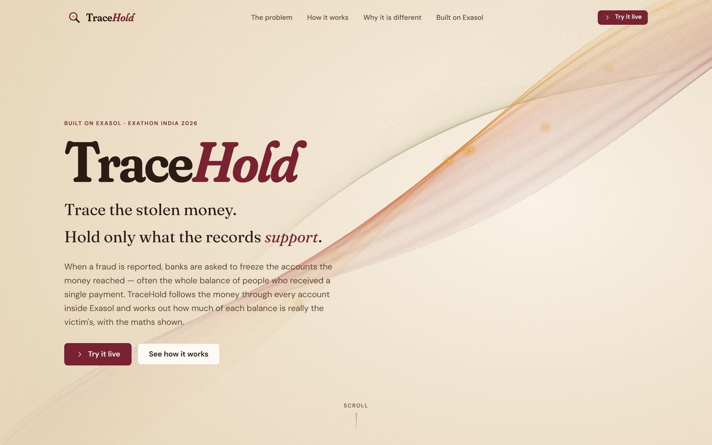
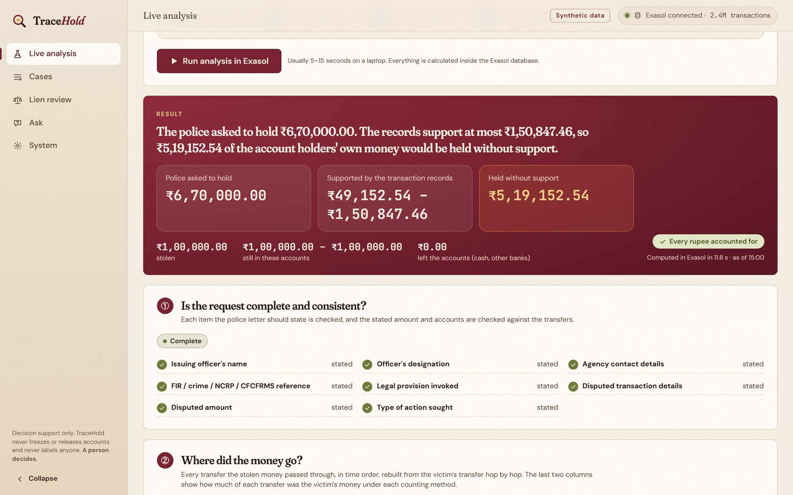
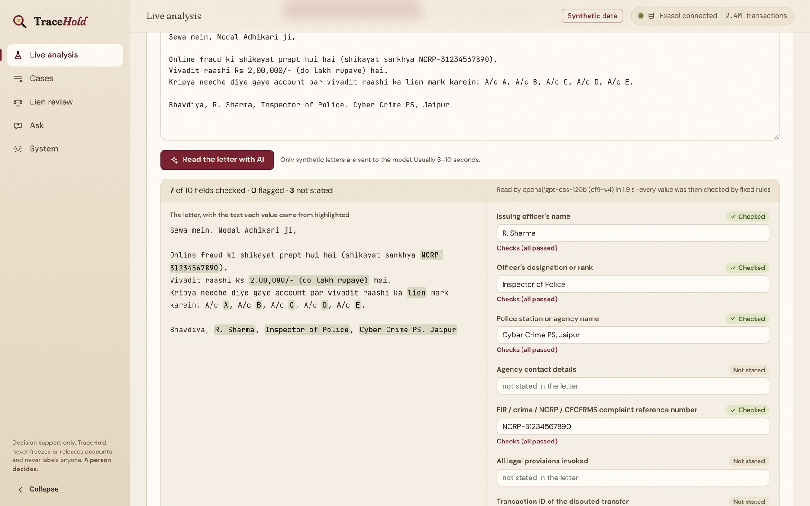
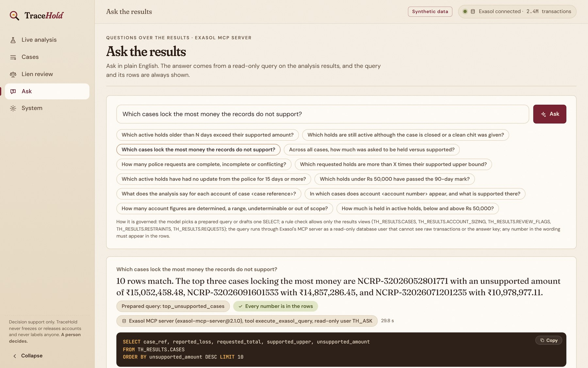
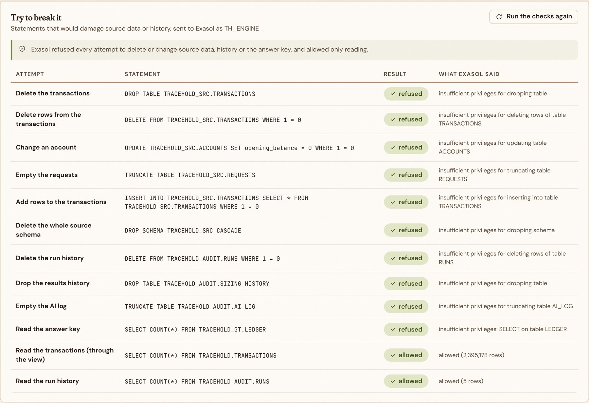

# TraceHold

**Trace the stolen money. Hold only what the records support.**

TraceHold is a decision-support tool for cyber-fraud account holds, built on **Exasol Personal** for
ExaThon India 2026 (Track 01: Money, Risk & Regulation).

When a fraud victim reports, the police ask banks to freeze the accounts that received the money. By then
the money has usually been split, mixed with other money and moved on, so banks often freeze whole
balances, including the savings of people who received a single payment. TraceHold reconstructs where the
reported money went and calculates, for every account, **how much of its balance the transaction records
can actually trace to the fraud**, as a range with the full calculation shown.

> TraceHold never freezes or releases anything, never decides guilt, and never labels anyone. A person decides.
> AI is used only at the edges (reading letters, answering questions, rewording a letter) and **never produces a figure**.
> All data in this project is **synthetic**.

---

## Links

| | |
|---|---|
| **Hackathon** | ExaThon India 2026 |
| **Track** | Track 01: Money, Risk & Regulation |
| **Demo video** | *Coming soon* |
| **Pitch deck** | [PDF](docs/TraceHold-Pitch-Deck.pdf) (opens in the browser) · [PowerPoint](docs/TraceHold-Pitch-Deck.pptx) |
| **Source code** | [github.com/lisamehta0791/TraceHold](https://github.com/lisamehta0791/TraceHold) |
| **Screenshots** | [Below](#screenshots) |
| **Run it yourself** | [Installation](#installation), then [Running TraceHold](#running-tracehold) |

## Screenshots

<p align="center">
  
</p>

<table>
  <tr>
    <td width="50%"><br><b>Live analysis:</b> the verdict first, asked to hold vs supported by the records</td>
    <td width="50%"><br><b>Reading a police letter with AI:</b> every value quotes the letter and is checked by rules</td>
  </tr>
  <tr>
    <td width="50%"><br><b>Ask the results:</b> plain-English questions through Exasol's MCP server, with the SQL shown</td>
    <td width="50%"><br><b>Try to break it:</b> Exasol refuses every attempt to change source data or history</td>
  </tr>
</table>

---

## Problem statement

An officer deciding how much of an account to hold in a cyber-fraud case can't tell how much of the victim's money
actually reached that account: it is split, mixed with other money and moved on within minutes, and requests often
arrive without the amount or the trail.

| Person | What they need | What goes wrong today |
|---|---|---|
| Fraud victim | The stolen money held before it moves on | Recovery is slow and low |
| Holder of an account the money passed through | A restriction limited to what is disputed | Whole-balance freezes, often without notice or a stated amount |
| Officer at the police cyber cell | To state the amount and basis of a hold | Mixed funds make the disputed share unclear |
| Bank nodal officer | To act lawfully and promptly | No way to check a requested amount, so blanket freezing is the safe default |
| State oversight officer | To spot prolonged or disproportionate freezes | No consolidated view of how long holds last or how big they are |

- **Too late for victims:** Bengaluru police reported ₹1,261 crore lost to online fraud up to August 2025, with only
  about 4% traced and returned (Deccan Herald).
- **Too broad for everyone else:** in August 2026 the Rajasthan High Court, hearing 105 petitions, found whole accounts
  frozen for disputed sums sometimes under ₹100 and freezes continuing after closure (news report; binding in
  Rajasthan only).
- **A rule without a calculator:** the 2 January 2026 procedure for CFCFRMS (as analysed by LiveLaw) limits a lien to
  the disputed sum. Applying it to a downstream account needs a defensible way to compute that sum, which is what
  TraceHold provides.

Not established: whether banks or agencies already size holds internally (only public descriptions were checked), or
how many innocent account holders are affected nationally. The figures above cover different places and must not be
combined.

## Features

**Analyse a case**

| Feature | Where to find it |
|---|---|
| **Request check**: is the police request complete and consistent? Drafts a clarification letter when something is missing | Live analysis step ①; case page → *Request check* |
| **Money trail**: follows the money hop by hop through splits, merges, loops, reversals, duplicate postings and clock skew | Live analysis step ②; case page → *Money path* |
| **Sizing**: how much of each account's balance traces to the fraud, under the pro-rata and FIFO methods, as a range with the traceable share; accounts in several cases are also reported combined | Live analysis step ③; case page account list and side panel |
| **Layer dilution**: how the disputed share thins out with each hop | Case page → *Layer dilution* |
| **Scope review**: compares the requested hold with the evidence (within evidence, within range, exceeds evidence, cannot determine), with facts for exceptional cases and no scores | Live analysis step ④; case page → *Scope review* |
| **Statuses and abstention**: Determined, Range, Undeterminable or Out of scope; no guessed number when records are missing | Every account figure |
| **Proportionate hold draft**: per account, a hold limited to the supported range (or chosen amounts), ready for the officer to review | Live analysis step ④; case page → *Scope review* |
| **Forwarded requests**: drafts for money that left the available records | Live analysis step ④; case page → *Forwarded requests* |
| **Evidence packet** (HTML and JSON) and a neutral **explanation for the account holder** | Case page → *Open evidence packet*, *Plain-language explanation* |
| **Reading police letters with AI**: free-text letters (English, Hinglish, Hindi) read field by field, checked by rules and confirmed by a person | Live analysis → *Read a police letter (AI)*; case page → *Request check* |
| **Checked AI rewording** of the account-holder explanation | Case page → *Plain-language explanation* → *Reword with AI (checked)* |

**Review and oversee**

| Feature | Where to find it |
|---|---|
| **Lien review queue**: existing holds ranked for a second look (over-held, closed but still held, past 90 days, past review date, escalate) | *Lien review* |
| **Oversight summary**: totals across all holds | *Lien review* (bottom) |
| **Ask the results**: plain-English questions answered through Exasol's MCP server, with the SQL and rows shown | *Ask* |

**Trust and transparency**

| Feature | Where to find it |
|---|---|
| **What it is based on**: the rules applied, every SQL script that ran (readable on the page), passes, timings, checksum and source fingerprints | Every result |
| **Live re-trace**: re-runs one case inside Exasol on all 2.4 million transactions in seconds and checks every figure against the stored result | Case page, top |
| **Data protection**: source data read-only for the analysis, append-only history, and live proof by refused statements | *System → Runs & history* |
| **Audit log and reproducible re-runs**: every run with its configuration and results checksum; any two runs can be compared | *System → Runs & history* |
| **The whole analysis as one Exasol script**: `EXECUTE SCRIPT TRACEHOLD.RUN_ANALYSIS()`, generated from the same SQL files, with the same checksum | *System → Runs & history* |

**Insights and performance**

| Feature | Where to find it |
|---|---|
| **Method sensitivity**: how much figures change under LIFO as a bounding case | Account side panel; *System → Insights* |
| **Policy simulation** and **speed of movement** across all cases | *System → Insights* |
| **Accuracy** of the engine and the AI features on the synthetic data | *System → Accuracy* |
| **Benchmark and Exasol at work**: Exasol vs PostgreSQL on the same SQL, plus statements, rows, compression and the indexes Exasol created by itself | *System → Performance* |
| **Accessibility**: WCAG 2.1 AA colour contrast, labels on every control, keyboard focus, skip link (checked with axe-core) | Everywhere |

## AI at the edges

| Area | AI? | How it is kept honest |
|---|---|---|
| Reading police letters | Yes, optional | The model must quote the exact text each value came from. Fixed rules then check that the quote is in the letter, that the value follows from it (amounts re-read in digits, English, Hinglish or Devanagari), formats, and the transaction records. Failed values are not used; two different values are a conflict and never resolved silently; a person confirms every field. |
| Request check, trail, sizing, statuses, evidence packet | **No** | Set-based SQL in Exasol with a conservation check. |
| Ask the results | Yes, optional | The query runs through **Exasol's MCP server** as a read-only database user that can see only results views (`TH_RESULTS`), never raw transactions or the answer key. The SQL and the rows are always shown; any number in the wording must appear in the rows. |
| Rewording the account-holder explanation | Yes, optional | A check confirms every amount, date, account and reference is unchanged and no claim is added; otherwise the template letter is kept. |

The model (Groq, `openai/gpt-oss-120b`) runs with temperature 0 and a fixed seed. Every call is logged in Exasol
(`AI_LOG`). Only synthetic data is ever sent. **With no API key, or with `TRACEHOLD_AI=off`, TraceHold works fully**
and every figure is identical (tested).

## Data protection and history

The analysis can never damage the source data or the history, and **Exasol enforces this, not the application**.
The app and the analysis connect as a limited database user, `TH_ENGINE`:

| Schema | Holds | The analysis may |
|---|---|---|
| `TRACEHOLD_SRC` | Source data: transactions, accounts, cases, police requests, holds, letters | **read only** |
| `TRACEHOLD` | Views of the source data, and the calculation tables rebuilt on every run | rebuild its own calculation tables |
| `TH_PLAYGROUND` | Scratch area for live analyses | rebuild |
| `TRACEHOLD_AUDIT` | Run log, results of every run, source fingerprints, every live analysis, AI log | **add rows only** |
| `TRACEHOLD_GT` | The generator's answer key | no access (scenario labels only) |

- **Why calculation tables are rebuilt:** every figure is recomputed from the untouched source data, so the same data
  always gives the same checksum. The `DROP TABLE` statements in the SQL only ever touch these calculation tables.
- **Proof, not promise:** *System → Runs & history → Try to break it* sends `DROP`, `DELETE`, `UPDATE`,
  `TRUNCATE` and `INSERT` statements against the source data, the history and the answer key as `TH_ENGINE`, and
  shows Exasol refusing each one ("insufficient privileges").
- **Second guard:** the engine also refuses any statement aimed at those tables before it reaches the database
  (`check_statement` in `backend/app/engine.py`), and a test checks every analysis SQL statement against it.
- **History:** every run keeps its steps, configuration, checksum and its full results (account figures, reviewed
  holds, case summaries, trail). Any two runs can be compared account by account. Every live analysis is kept too.
- **Fingerprints:** each run records the row count and an MD5-based fingerprint of every source table before and
  after, and fails if anything changed. Shown on every run and in *What it is based on*.

## How it works

```
 synthetic data generator ──► Exasol Personal ──► SQL analysis engine (runs inside Exasol) ──► result tables
   (backend/generator)          (all data)          (database/*.sql)                            │
                                                                                                 ▼
                                               website (frontend) ◄── FastAPI (backend/app) ◄────┘
                                                                         │  ▲
                                          Groq model (letters, wording) ─┘  └─ Exasol MCP server (read-only questions)
```

1. **Generate**: a synthetic banking economy (about 136,000 accounts, 2.4 million transactions) with 2,400 fraud
   cases in nine patterns, injected data defects, synthetic police letters, and a separate answer key.
2. **Load**: the files are bulk-loaded into Exasol.
3. **Analyse inside Exasol**: set-based SQL cleans the postings, rebuilds every account's running balance, follows
   the stolen money layer by layer, allocates it under the pro-rata, FIFO and LIFO methods, checks every request
   and compares it with the evidence. No row-by-row processing happens outside the database.
4. **Serve**: the API reads the result tables; the website shows and explains them.

The analysis steps are the numbered files in `database/` (prepare, trace, trail, sizing, requests, review, lien
review, evidence). The trail is followed with a layer pass repeated until nothing changes, because Exasol Personal
has no recursive queries.

## Method

**Methods for mixed money.** Once disputed money is mixed, which part of a balance is "disputed" depends on a
convention, so three are computed side by side for every case:

- **Pro-rata:** each outgoing payment carries the account's current disputed proportion. A running sum of
  `ln(1 - share)` turns this sequential rule into window functions and one join.
- **FIFO:** money leaves in the order it arrived. Each account has a cumulative-inflow axis; a payment consumes an
  interval of it and carries the disputed part of that interval onward.
- **LIFO (bounding case only):** the most recent money leaves first; used to show how sensitive a figure is.

The supported range is the span of pro-rata and FIFO.

**Shared rules.** Only completed postings count, and a completed reversal reduces the original transfer. Duplicate
postings are dropped. A payment beyond the balance overdraws, and the next credit repays that first. Transfers
carrying less than ₹1 of a case's money under a method are not followed further. Tracing stops at the case's
reference time. Money returned to the victim, withdrawn as cash, taken as charges or sent outside the records leaves
the trail. A debit that overdraws and is cured by a credit within 120 seconds is treated as clock skew and reordered.

**Conservation check.** For every case and method: still in accounts + left the records + below ₹1 + repaid
overdrafts = reported loss. Any failure is a calculation defect.

| Status | When |
|---|---|
| Determined | Pro-rata and FIFO agree to the paisa and the records are complete |
| Range | The methods disagree; both ends are reported |
| Undeterminable | Missing opening balance, a gap in the records, or money received from such an account |
| Out of observable scope | Money moved outside the records; a forwarded request is drafted |

**Validation.** The generator (`backend/generator/ledger.py`) has an independent row-by-row implementation of the
same three methods using explicit queues and stacks, and `backend/app/evaluation.py` compares the SQL engine with it.
The AI letter reader is tuned on 24 development letters and measured on 60 held-out letters whose answer key it
never reads.

**Known limitations.**

- The methods are estimation tools, not legal findings about who owns money.
- Clock-skew correction is a heuristic; a records gap is detected only through the closing statement balance.
- The lien review rules follow a commentary on the 2 January 2026 procedure and must be checked against the primary
  text; they are configurable (`Config` in `backend/app/engine.py`).
- All data is synthetic; AI results are measured on synthetic letters and fixed question sets, not real-world
  accuracy.

## Tech stack

| Layer | Technology |
|---|---|
| Database and analytics | Exasol Personal (nano runtime in Docker) |
| Analysis | SQL (window functions, set-based iteration), orchestrated from Python |
| Backend | Python 3.11+, FastAPI, pyexasol |
| AI (optional) | Groq API (`openai/gpt-oss-120b`), Exasol's open-source MCP server (`exasol-mcp-server`, in the project's `.venv-mcp`) |
| Frontend | React 18, TypeScript, Vite, Motion, Recharts |
| Tests | pytest (unit, property, determinism, separation, AI-off), Playwright for browser checks |

## Project structure

```
TraceHold/
├── backend/
│   ├── app/            FastAPI app, analysis orchestrator, loader, live-analysis engine, evaluation
│   │   └── ai/         AI at the edges: Groq client and log, letter reading, questions via MCP, rewording
│   ├── generator/      synthetic data, police letters, and the independent ground-truth ledger
│   ├── benchmark/      benchmark harness
│   ├── results/        evaluation, AI evaluation and benchmark results (JSON)
│   ├── tests/          pytest suite
│   └── requirements.txt
├── database/           every SQL script that runs inside Exasol (source, audit and answer-key schemas, analysis steps, AI)
├── frontend/           the website (src/pages, src/components)
├── docs/               pitch deck and screenshots
├── CONTRIBUTING.md     how to contribute
├── data/               generated datasets (created locally, not committed)
├── .env.example        settings template (copy to .env; never commit .env)
├── .venv-mcp/          Exasol's MCP server, installed by the AI setup (not committed)
├── setup.ps1           optional one-command start (Windows)
└── stop.ps1            stops the database cleanly
```

## Requirements

- Windows 10/11 with **Docker Desktop**
- **Exasol Personal starter kit**: https://github.com/exasol/exasol-personal (creates the database password file
  `%USERPROFILE%\.exasol-starter-kit\credentials\nano_sys_password`)
- **Python 3.11+** and **Node.js 20+**
- About 8 GB RAM and 3 GB free disk space
- For the AI features (optional): a **Groq API key** (https://console.groq.com). Exasol's open-source MCP server is
  installed automatically inside the project (`.venv-mcp`) by the AI setup step

## Installation

Run these once, in PowerShell, from the project folder.

**1. Start the Exasol database (first time only)**

```powershell
$pw = "$env:USERPROFILE\.exasol-starter-kit\credentials\nano_sys_password"
docker volume create lienlens-exasol-data
docker run -d --name exasol-nano --shm-size=512m -m 3g -p 127.0.0.1:8563:8563 `
  -v lienlens-exasol-data:/exa -v "${pw}:/run/secrets/sys_password:ro" `
  exasol/nano:2026.2.0-nano.3-amd64 init sys_password_file=/run/secrets/sys_password
docker logs -f exasol-nano        # wait for "Database is now up and running", then Ctrl+C
```

The `init` command is only valid the first time, so recreate the container without it:

```powershell
docker stop -t 180 exasol-nano; docker rm exasol-nano
docker run -d --name exasol-nano --restart unless-stopped --stop-timeout 180 --shm-size=512m -m 3g `
  -p 127.0.0.1:8563:8563 -v lienlens-exasol-data:/exa exasol/nano:2026.2.0-nano.3-amd64
```

**2. Install the backend and the frontend**

```powershell
python -m venv .venv
.\.venv\Scripts\python -m pip install -r backend\requirements.txt
cd frontend
npm install
cd ..
```

**3. Generate the data, load it and run the analysis**

```powershell
python backend\generator\generate.py --scale 1.0 --seed 2026 --out data\L     # 2-3 minutes
python backend\generator\letters.py data\L                                     # synthetic police letters
cd backend
..\.venv\Scripts\python -m app.load ..\data\L --fresh                         # about 1 minute; also sets up the protected layout
..\.venv\Scripts\python -m app.engine                                         # 2-4 minutes (add --lua to run it as one Exasol script)
..\.venv\Scripts\python -m app.evaluation                                     # about 1 minute
cd ..
```

Use `--scale 0.2` for a smaller, faster dataset. The analysis prints each step as it runs.

Loading creates the protected layout and the limited user `TH_ENGINE` automatically (its password is stored in
`.env`). To set it up on an existing database, or to re-run the protection checks, run `python -m app.secure`
from the `backend` folder; it moves existing tables only after verifying every copy. `--fresh` replaces the source
data but never the history.

**4. Set up the AI features (optional)**

Copy `.env.example` to `.env` and put your Groq key in it:

```
GROQ_API_KEY=your_key_here
```

Then install Exasol's MCP server in the project, create the AI tables, load the letters and create the read-only
question user:

```powershell
cd backend
..\.venv\Scripts\python -m app.ai_setup
cd ..
```

It prints a check that the question user can read the results views and **cannot** read raw transactions or the
answer key. Its password is stored in `.env`. Reloading the data with `--fresh` removes the AI tables; TraceHold
recreates them (and reloads the letters) automatically the next time an AI feature is used.

## Running TraceHold

The website needs the **backend API** running, and the backend needs **Exasol** running.

**1. Make sure Exasol is running**

```powershell
docker start exasol-nano
```

**2. Start the backend API** (terminal 1, keep it open)

```powershell
cd backend
..\.venv\Scripts\python -m uvicorn app.main:app --host 127.0.0.1 --port 8000
```

Restart it (`Ctrl+C`, then the same command) whenever the backend code changes.

**3. Open the website**, either way:

- **Built website, served by the backend:** build once, then open http://127.0.0.1:8000

  ```powershell
  cd frontend
  npm run build
  ```

- **Development server with hot reload** (terminal 2): open http://localhost:5173

  ```powershell
  cd frontend
  npm run dev
  ```

  The development server forwards `/api` to the backend on port 8000. If the backend is not running, it prints
  one message saying how to start it, and the pages show the same message.

**Stopping:** press `Ctrl+C` in the backend and frontend terminals, then stop the database cleanly:

```powershell
docker stop -t 180 exasol-nano      # or: .\stop.ps1
```

Always give Exasol time to shut down (`-t 180`). Killing it mid-write can corrupt its storage.

**Optional shortcut:** `.\setup.ps1` performs the steps above automatically: it starts Docker and Exasol, installs
what is missing, loads data and runs the analysis only if they are missing, sets up the AI features, builds the
website and starts the backend. Run it with `powershell -ExecutionPolicy Bypass -File .\setup.ps1`.

## Using the app

| Page | Use it to |
|---|---|
| **Home** (`/`) | Read what TraceHold does and why. |
| **Live analysis** | Pick a demo scenario, enter your own accounts and transfers, or **read a police letter with AI**. Press **Run analysis in Exasol**: the verdict comes first (asked to hold vs supported), then six explained steps ending with the rules and SQL used. |
| **Cases** | Browse the 2,400 stored cases (*All cases*) or the totals (*At a glance*). Open a case to **re-trace it live** on the full ledger, click an account, and open **How it was calculated** or **What it is based on**. *Scope review* drafts a proportionate hold. **Open evidence packet** gives the printable report. |
| **Lien review** | Filter existing holds by problem and open the case behind any hold. |
| **Ask** | Ask a question in plain English or click a suggested one. The answer shows the SQL that ran through Exasol's MCP server and the rows. |
| **System** | *Accuracy* (engine and AI), *Insights*, *Runs & history* (re-run the analysis, compare runs, live analyses, AI calls, try to break the data protection) and *Performance* (benchmark, Exasol at work). |

A short demo path: **Live analysis → Read a police letter (AI)** → pick *Split, merge and cash-out* and the
*Hinglish message* → **Read the letter with AI** → confirm → **Run analysis in Exasol**. The missing contact and legal
provision are flagged, the over-broad lien is shown and a proportionate hold is drafted. Then open a stored case,
re-trace it live on the full ledger, and try to break the data protection on *System → Runs & history*.

## Tests and evaluation

```powershell
cd backend
..\.venv\Scripts\python -m pytest tests          # 47 tests; database tests are skipped if Exasol is not running
..\.venv\Scripts\python -m app.evaluation        # accuracy against the generator's answer key
..\.venv\Scripts\python -m app.ai_eval           # AI features on held-out letters (needs GROQ_API_KEY; 20-30 min)
```

The tests cover the worked example to the paisa, conservation on random cases, determinism (same case twice, same
evidence packet twice), that the analysis never reads the answer key, that the calculation path never imports the
AI package, the AI-off test, the read-only question user, every rule check that runs after an AI call, and that
Exasol refuses the analysis user any change to source data, history or the answer key.

## Results on the synthetic data

Large dataset: 2,395,178 transactions and 2,400 cases (`backend/results/evaluation.json`):

| Measure | Result |
|---|---|
| Worked example (₹1,00,000 through three accounts, ₹6,70,000 requested) | reproduced to the paisa: at most ₹1,50,847 supported |
| Conservation (every rupee accounted for) | 7,200 / 7,200 checks pass |
| Amounts vs an independent ledger | 99.85% (pro-rata) and 99.91% (FIFO) of account figures within one paisa |
| Request-defect detection | 100% precision, 100% recall (946 planted defects, 14 types) |
| Money-trail reconstruction | 99.4% precision, 99.9% recall |
| Over-broad requests flagged | 3,588 of 3,589, no false flags |
| Reproducibility | re-runs on the same data give the same results checksum |

AI features (`backend/results/ai_evaluation.json`; prompts tuned on 24 development letters, results on 60 held-out letters):

| Measure | Result |
|---|---|
| Letter reading: field extraction | 98.8% precision, 99.2% recall; 90% of letters with every field right |
| Letter reading: values used without a quote from the letter | 0 |
| Letter reading: planted conflicting amounts flagged | 4 of 4 |
| Letter reading: fields a person would have to correct | 1.2% |
| Ask: questions answered with the same rows as hand-written SQL | 10 of 10, plus 2 of 2 out-of-scope questions refused |
| Ask: wordings rejected by the number check | 0 of 12 |
| Rewording: rewordings that kept every fact | 8 of 8 |
| AI-off test | figures identical with AI off and on |

These figures describe synthetic data only. They are not evidence of real-world performance.

**Benchmark** (`backend/results/benchmark.json`, *System → Performance*). Same SQL, same data, same laptop
(Intel i5-1135G7, 8 GB RAM), each database alone in Docker with up to 4 GB of memory; PostgreSQL 16 tuned and given
the indexes a reasonable engineer would add, Exasol on its defaults. Medians of repeated warm runs:

| Workload | 241k transactions | 958k transactions |
|---|---|---|
| Full analysis (clean, balances, trace and size every case) | Exasol 27.8 s · PostgreSQL 38.9 s (1.4×) | **Exasol 43.8 s · PostgreSQL 343.6 s (7.8×)** |
| One case on the prepared ledger | Exasol 5.0 s · PostgreSQL 1.1 s | Exasol 10.6 s · PostgreSQL 2.9 s |
| Lien-review queue | Exasol 0.34 s · PostgreSQL 0.08 s | Exasol 0.57 s · PostgreSQL 0.18 s |

Exasol wins the heavy analytical workload and the gap widens with the data (4× more data: Exasol 1.6× slower,
PostgreSQL 8.8× slower). PostgreSQL is faster on small, quick queries; both answer those within seconds. The full
2.4-million-transaction run on Exasol takes 2 to 4 minutes on this laptop. Only these workloads were measured; synthetic data only.

## API

The backend serves JSON under `/api` (interactive docs at http://127.0.0.1:8000/docs).

| Endpoint | Returns |
|---|---|
| `GET /api/health` | database status and row counts |
| `GET /api/overview` | totals across all cases |
| `GET /api/cases`, `GET /api/cases/{id}` | case list (search, filter, pages) and one case with trail and sizing |
| `GET /api/cases/{id}/explain/{account}` | step-by-step calculation for one account |
| `GET /api/cases/{id}/basis`, `GET /api/basis/sql/{script}` | rules, run steps and the SQL text behind a result |
| `GET /api/cases/{id}/packet`, `/packet.html`, `/explanation/{account}` | evidence packet and account-holder explanation |
| `GET /api/playground/scenarios`, `POST /api/playground/run` | live analysis demos and runs |
| `GET /api/lien-review`, `GET /api/oversight` | existing holds ranked for review |
| `GET /api/evaluation`, `GET /api/policy-sim`, `GET /api/speed`, `GET /api/sensitivity` | accuracy and insights |
| `GET /api/runs`, `POST /api/runs`, `GET /api/runs/{id}` | analysis runs (start one, follow its steps) |
| `POST /api/cases/{id}/retrace` | live re-trace of one case on the full ledger |
| `POST /api/cases/{id}/hold-draft`, `POST /api/hold-draft` | proportionate hold draft (stored case / live analysis) |
| `GET /api/protection`, `GET /api/history/compare`, `GET /api/live-analyses` | protection proof, run comparison, live-analysis history |
| `GET /api/exasol` | Exasol system statistics for the latest run |
| `GET /api/ai/status`, `GET /api/ai/log`, `GET /api/ai/evaluation` | AI set-up, call log and measured results |
| `GET /api/ai/letters`, `GET /api/cases/{id}/letter`, `POST /api/ai/extract`, `POST /api/ai/extract/{id}/confirm` | police letters: reading with AI and confirmation |
| `GET /api/ai/ask/templates`, `POST /api/ai/ask` | questions through Exasol's MCP server |
| `POST /api/cases/{id}/explanation/{account}/reword` | checked AI rewording of the account-holder explanation |

## Troubleshooting

| What you see | Cause and fix |
|---|---|
| `npm run dev` prints proxy / `ECONNREFUSED` errors, pages say the API is not running | The backend is not running. Start it (see [Running TraceHold](#running-tracehold), step 2). |
| Pages fail after updating TraceHold | Run `python -m app.secure` (from `backend`) once, then restart the backend. |
| A page shows "This part of the page could not be shown" | The backend is older than the website. Restart the backend and reload the page. |
| Page says "analysis results are not in Exasol yet" | Run the analysis once: `cd backend` then `..\.venv\Scripts\python -m app.engine`. |
| Page says "an analysis run is rebuilding the results" | A run is in progress; the page reloads by itself when it finishes (2-4 minutes). If the run was interrupted (for example the backend was restarted mid-run), it is marked as failed within about 15 seconds and the last complete results are shown again. |
| AI buttons say "AI is off" | Add `GROQ_API_KEY` to `.env` and restart the backend. Everything else works without it. |
| *Ask* says the read-only user or the MCP server is not set up | Run `python -m app.ai_setup` from the `backend` folder. |
| AI calls are slow | Groq's free tier allows about 8,000 tokens a minute; TraceHold waits and retries automatically. |
| Backend cannot connect to Exasol | `docker start exasol-nano` and wait about a minute; check `docker logs --tail 20 exasol-nano`. |
| Exasol stops or crashes under load | Give Docker more memory (Docker Desktop → Settings → Resources, or `memory=` in `%USERPROFILE%\.wslconfig`). |
| Port 8000 is busy | Find it with `netstat -ano \| findstr :8000`, or start the backend with `--port 8010` and run the dev server with `$env:TRACEHOLD_API_PORT=8010; npm run dev`. |

## Responsible use

- Decision support only: the system never places, changes or releases a hold.
- Results are ranges with a status; the system abstains when records are incomplete.
- No model produces or changes a figure; AI output always carries its evidence and is checked by rules.
- Neutral wording for account holders; no suspicion scores or labels.
- Only synthetic data is processed or sent to any model.
- References to court directions and procedures are context, not legal advice.

## Licence

[MIT](LICENSE) © 2026 Lisa Mehta
